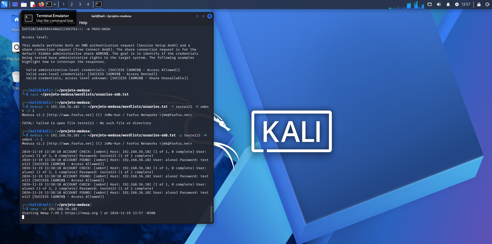
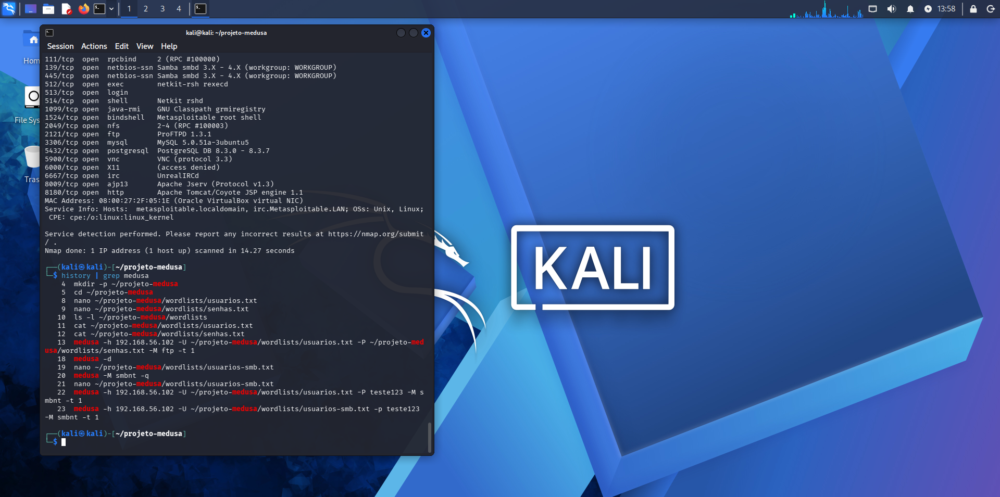
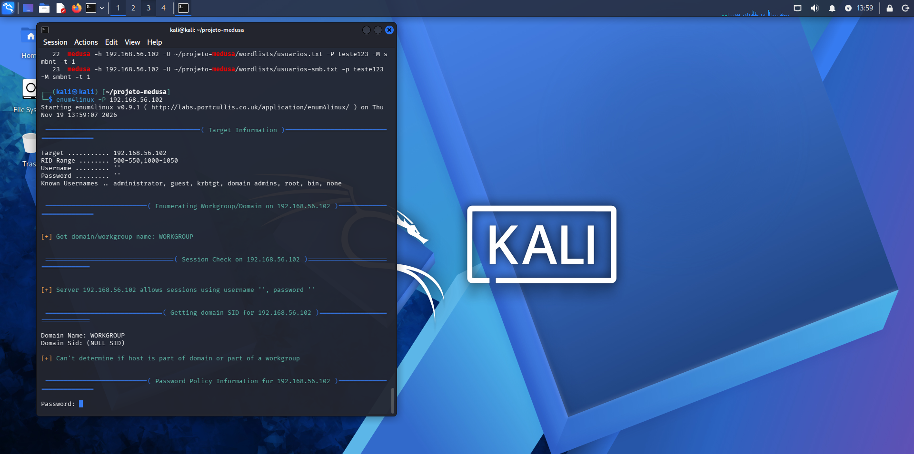
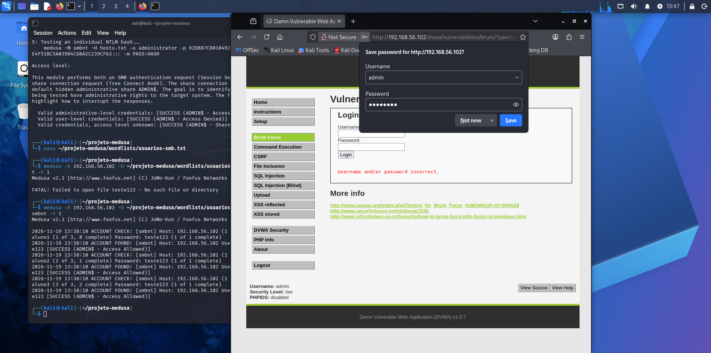

Laboratório de Cibersegurança - DIO
=================================

**Sobre o projeto**

Este projeto foi desenvolvido como parte de um desafio prático de cibersegurança da DIO, com foco na análise de vulnerabilidades, enumeração de serviços, ataques de força bruta, Password Spraying e mecanismos de proteção contra tentativas de autenticação.

Todos os procedimentos foram realizados em um ambiente virtual controlado e isolado, utilizando máquinas próprias e propositalmente vulneráveis.

---

**Objetivos**

- Configurar um ambiente virtual para testes de segurança.
- Identificar portas abertas e serviços disponíveis.
- Compreender ataques de força bruta.
- Realizar testes de autenticação utilizando o Medusa.
- Identificar usuários através da enumeração SMB.
- Demonstrar os riscos da reutilização de senhas.
- Analisar mecanismos de proteção em aplicações web.
- Apresentar recomendações de segurança.

---

**Ferramentas utilizadas**

| Ferramenta | Finalidade |
|---|---|
| VirtualBox | Virtualização do ambiente |
| Kali Linux | Sistema operacional para testes |
| Metasploitable 2 | Sistema propositalmente vulnerável |
| Nmap 7.99 | Mapeamento de portas e serviços |
| Medusa 2.3 | Testes de autenticação |
| Enum4linux | Enumeração de usuários SMB |
| DVWA | Análise de segurança web |

---

**Configuração do ambiente**

O laboratório foi configurado utilizando duas máquinas virtuais no VirtualBox.

| Configuração | Informação |
|---|---|
| Máquina de testes | Kali Linux |
| Máquina vulnerável | Metasploitable 2 |
| Aplicação web | DVWA |
| Rede de testes | Host-Only |
| Endereço IP do alvo | 192.168.56.102 |
| Memória RAM do Kali | 4 GB |
| Memória RAM do Metasploitable | 1 GB |

A rede Host-Only foi utilizada para manter os testes isolados das redes externas.

---

**1. Teste de conectividade**

Inicialmente, foi realizado um teste de comunicação entre o Kali Linux e o Metasploitable 2 utilizando o protocolo ICMP.

Comando utilizado:

    ping -c 4 192.168.56.102

Resultados obtidos:

- Pacotes enviados: 4.
- Pacotes recebidos: 4.
- Perda de pacotes: 0%.
- Latência média: 18,428 ms.

O resultado confirmou a comunicação entre as máquinas virtuais.

---

**2. Mapeamento de portas e serviços**

A ferramenta Nmap foi utilizada para identificar portas abertas e versões dos serviços disponíveis no Metasploitable 2.

Comando utilizado:

    nmap -sV 192.168.56.102

A varredura identificou 23 portas TCP abertas e 977 portas fechadas, sendo concluída em 14,60 segundos.

| Porta | Serviço | Versão |
|---|---|---|
| 21 | FTP | vsftpd 2.3.4 |
| 22 | SSH | OpenSSH 4.7p1 |
| 23 | Telnet | Linux telnetd |
| 25 | SMTP | Postfix |
| 53 | DNS | ISC BIND 9.4.2 |
| 80 | HTTP | Apache 2.2.8 |
| 139 | NetBIOS | Samba 3.X - 4.X |
| 445 | SMB | Samba 3.X - 4.X |
| 3306 | MySQL | 5.0.51a |
| 5432 | PostgreSQL | 8.3.0 - 8.3.7 |

**Evidência do teste**

---

**3. Teste de autenticação FTP**

Após identificar o serviço FTP disponível na porta 21, foi realizado um teste de autenticação utilizando a ferramenta Medusa.

Foram criados arquivos de texto contendo pequenas listas de usuários e senhas destinadas exclusivamente ao ambiente de laboratório.

O objetivo foi demonstrar como credenciais fracas e previsíveis podem comprometer a segurança de um serviço.

**Resultado**

O teste identificou uma credencial válida, permitindo realizar a autenticação no serviço FTP.

Posteriormente, a credencial foi validada através de uma conexão FTP, confirmando o acesso ao serviço.

**Evidência do teste**

---

**4. Enumeração de usuários SMB**

A ferramenta Enum4linux foi utilizada para identificar contas de usuários disponíveis no serviço SMB do Metasploitable 2.

Durante a enumeração, foi possível obter informações sobre diferentes contas do sistema sem fornecer credenciais.

Foram identificadas as seguintes fragilidades:

- Exposição de nomes de usuários.
- Possibilidade de enumeração anônima.
- Divulgação de informações internas.
- Configurações inadequadas de segurança.

---

**5. Análise da política de senhas**

Foi realizada uma consulta à política de senhas do serviço SMB para identificar possíveis fragilidades relacionadas à autenticação.

| Configuração | Resultado |
|---|---|
| Tamanho mínimo da senha | 5 caracteres na consulta principal |
| Complexidade de senhas | Desativada |
| Histórico de senhas | Não configurado |
| Validade máxima da senha | Não definida |
| Limite de tentativas | Não configurado |
| Duração do bloqueio | 30 minutos |

A consulta parcial realizada pelo rpcclient apresentou um tamanho mínimo de zero caracteres, indicando uma divergência que necessita de validação adicional.

A ausência de limite de tentativas e de requisitos adequados de senha demonstra uma configuração vulnerável.

**Evidência do teste**

---

**6. Simulação de Password Spraying**

O Password Spraying consiste na utilização de uma mesma senha em diferentes contas de usuários.

Para realizar a demonstração, foram criadas três contas fictícias no Metasploitable 2 e cadastradas no serviço Samba.

| Usuário | UID |
|---|---|
| aluno01 | 1003 |
| aluno02 | 1004 |
| aluno03 | 1005 |

As três contas foram configuradas com a mesma senha para demonstrar os riscos associados à reutilização de credenciais.

**Evidência dos usuários cadastrados**

**Resultados obtidos**

| Usuário | Resultado |
|---|---|
| aluno01 | Sucesso |
| aluno02 | Sucesso |
| aluno03 | Sucesso |

- Total de contas testadas: 3.
- Autenticações bem-sucedidas: 3.
- Taxa de sucesso observada: 100%.

O resultado demonstrou que a reutilização de uma mesma senha em diferentes contas pode comprometer múltiplos usuários.

A captura do resultado final do Medusa para SMB não está disponível entre as evidências atuais.

---

**7. Análise de segurança web com DVWA**

O DVWA, Damn Vulnerable Web Application, é uma aplicação desenvolvida propositalmente com vulnerabilidades para fins educacionais.

Durante essa etapa, foram realizados testes manuais no formulário Brute Force, utilizando os níveis de segurança Low e High.

**Autenticação incorreta**

Foi realizada uma tentativa utilizando uma senha incorreta para observar o comportamento da aplicação. O sistema rejeitou a tentativa de acesso.

**Autenticação correta**

Foi realizada uma tentativa utilizando a credencial válida do ambiente de laboratório. O sistema permitiu a autenticação.

**Comparação dos níveis de segurança**

| Característica | Low | High |
|---|---|---|
| Autenticação incorreta | Rejeitada | Rejeitada |
| Tempo de resposta | Rápido | Mais demorado |
| Resistência à força bruta | Menor | Maior |

Durante os testes, foi observado que o nível High apresentou um atraso na resposta após uma tentativa de autenticação incorreta.

Esse mecanismo reduz a velocidade de tentativas repetidas de autenticação.

O tempo exato das respostas não foi medido. Os testes foram realizados manualmente, sem automatização pelo Medusa.

---

**8. Vulnerabilidades identificadas**

| Vulnerabilidade | Impacto |
|---|---|
| Credenciais fracas | Possibilidade de acesso indevido |
| Reutilização de senhas | Comprometimento de múltiplas contas |
| Enumeração anônima | Exposição de usuários |
| Ausência de limite de tentativas | Facilita tentativas repetidas |
| Serviços desatualizados | Exposição a vulnerabilidades conhecidas |
| Utilização de FTP | Ausência de criptografia por padrão |

---

**9. Recomendações de segurança**

Com base nos testes realizados, são recomendadas as seguintes medidas:

- Utilizar senhas fortes, longas e exclusivas.
- Evitar a reutilização de credenciais.
- Implementar autenticação multifator quando disponível.
- Limitar tentativas de autenticação.
- Configurar políticas adequadas de bloqueio de contas.
- Monitorar atividades e acessos suspeitos.
- Restringir consultas anônimas no serviço SMB.
- Substituir FTP por protocolos seguros, como SFTP.
- Manter sistemas operacionais e serviços atualizados.
- Desativar serviços desnecessários.
- Realizar auditorias de segurança periodicamente.

---

**10. Resultados gerais**

| Procedimento | Status |
|---|---|
| Configuração do laboratório | Concluído |
| Teste de conectividade | Concluído |
| Mapeamento Nmap | Concluído |
| Teste FTP | Concluído |
| Enumeração SMB | Concluído |
| Análise da política de senhas | Concluído |
| Password Spraying | Concluído |
| Teste manual DVWA | Concluído |
| Análise de mecanismos de proteção | Concluído |
| Documentação | Concluído |

---

**Conhecimentos adquiridos**

Durante o desenvolvimento deste projeto, foram aplicados conhecimentos relacionados a:

- Segurança da informação.
- Redes de computadores.
- Virtualização de sistemas.
- Administração de sistemas Linux.
- Mapeamento de portas e serviços.
- Enumeração de usuários.
- Testes de autenticação.
- Análise de vulnerabilidades.
- Políticas de segurança.
- Documentação técnica.
- Utilização do GitHub.

---

**Conclusão**

O desenvolvimento deste laboratório possibilitou a aplicação prática de conceitos de cibersegurança, permitindo compreender como configurações inadequadas, serviços desatualizados e senhas fracas podem comprometer a segurança de um sistema.

Os testes realizados demonstraram a importância da implementação de políticas de autenticação, mecanismos de proteção, monitoramento de acessos e boas práticas de segurança da informação.

Além dos conhecimentos técnicos, o projeto contribuiu para o desenvolvimento de habilidades de análise, investigação, resolução de problemas e documentação técnica.

---

**Aviso legal**

Este projeto possui finalidade exclusivamente educacional. Todos os testes foram realizados em máquinas virtuais próprias, em um ambiente autorizado, controlado e isolado.

As ferramentas e técnicas apresentadas não devem ser utilizadas contra sistemas ou redes sem autorização.

---

**Referências**

- [DIO](https://www.dio.me/)
- [Kali Linux](https://www.kali.org/)
- [VirtualBox](https://www.virtualbox.org/)
- [Nmap](https://nmap.org/)
- [Medusa](https://github.com/jmk-foofus/medusa)
- [DVWA](https://github.com/digininja/DVWA)

---

**Licença**

Este projeto está sob a licença MIT.

**Autor**

Pedro Lucas Lopes da Silva

[GitHub](https://github.com/PedroLuucasz)
